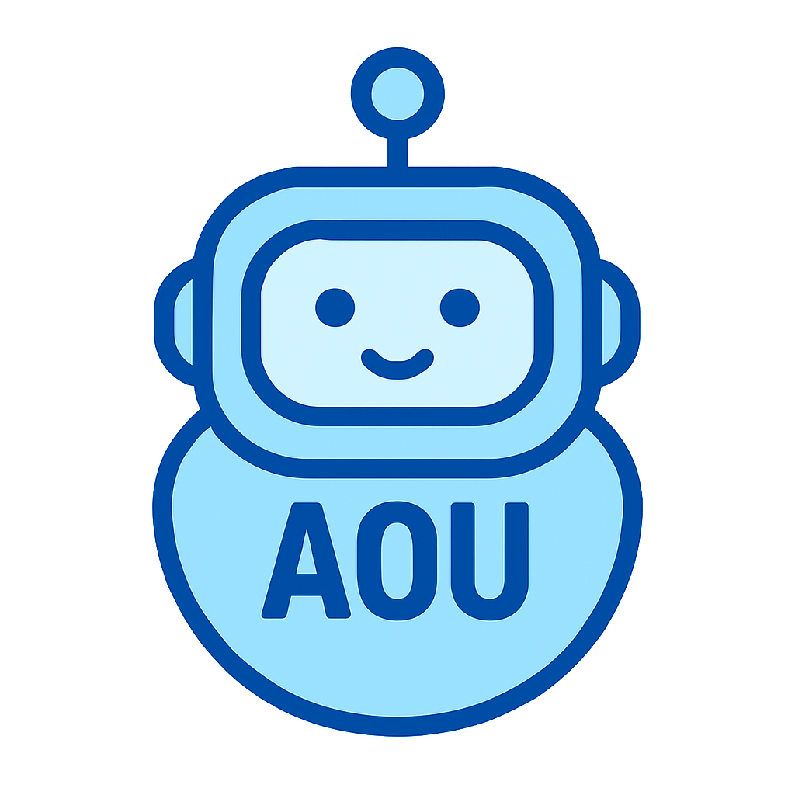
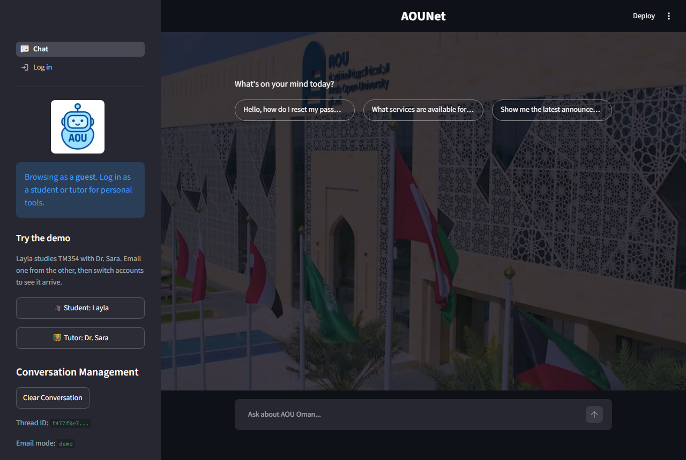
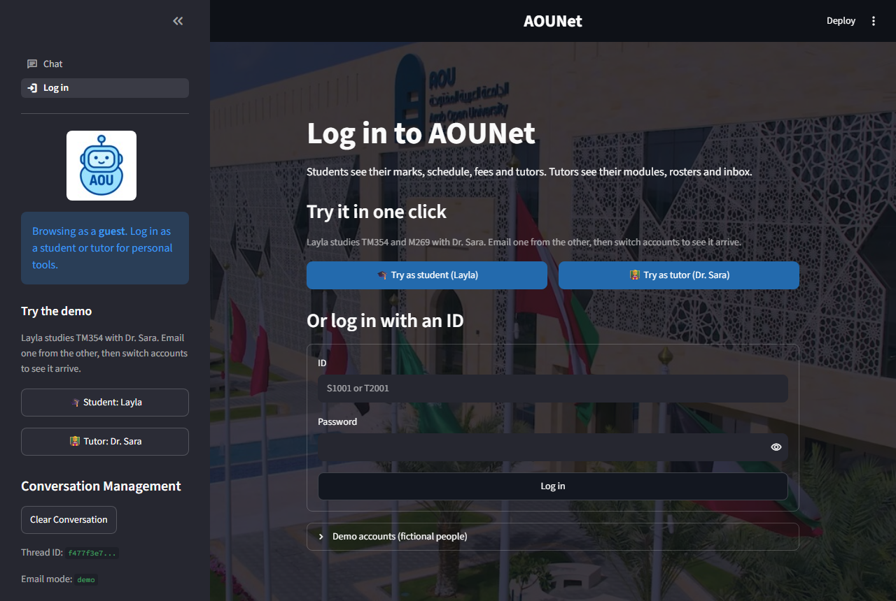
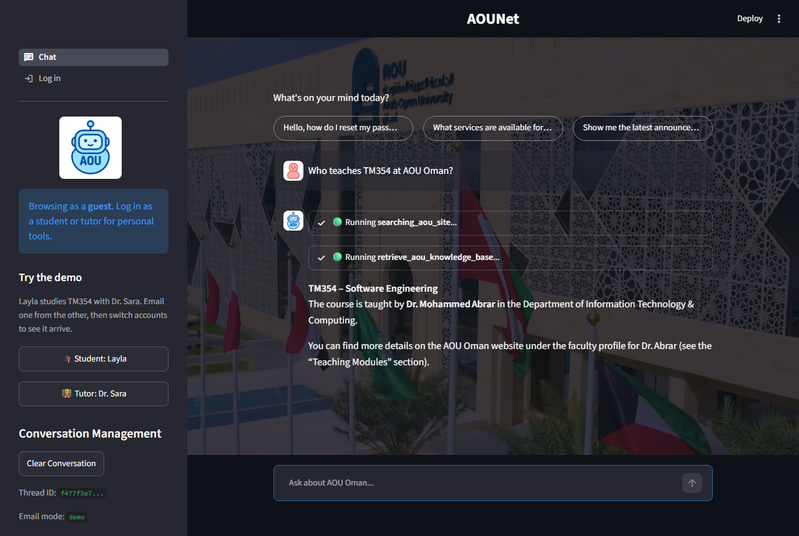
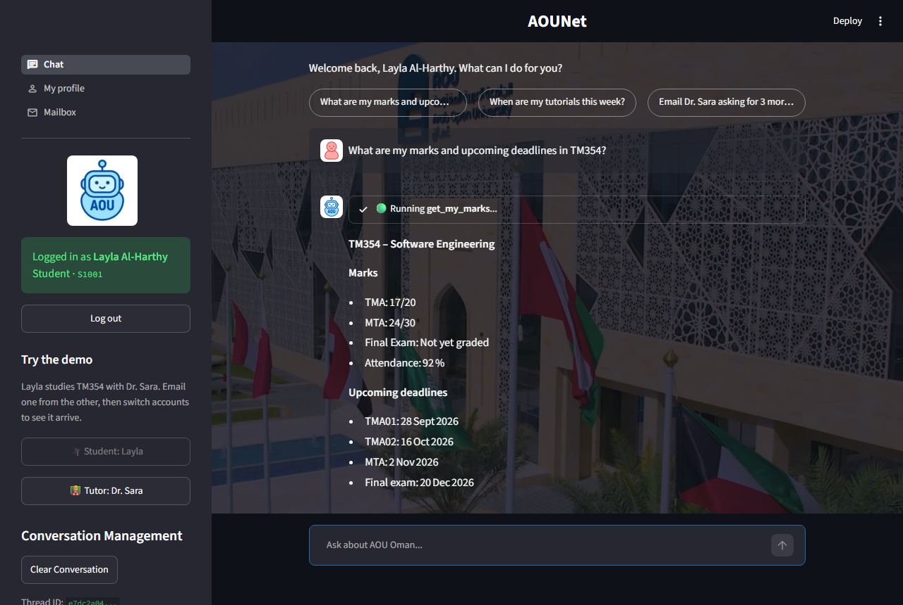
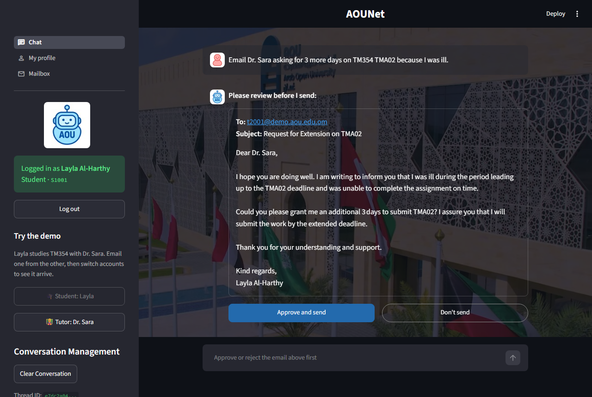
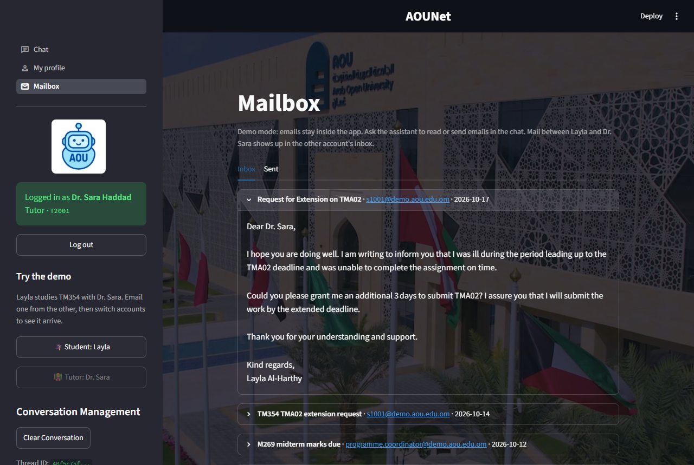
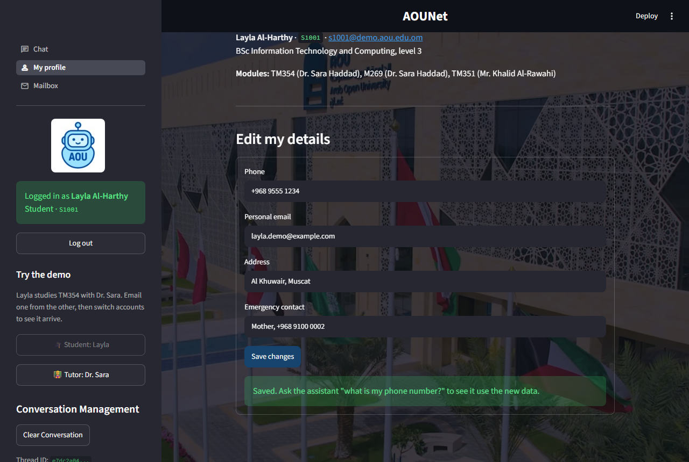
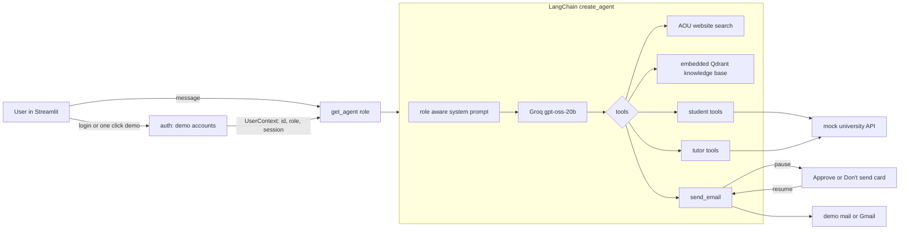

<div align="center">



# AOUNet

**An AI assistant for Arab Open University, Oman. One chat for guests, students and tutors.**

Guests ask about admissions and programs. Students check their marks, deadlines, schedule, fees and tutors.
Tutors check their rosters, read their inbox and send emails, with a human approval step before anything goes out.

**Try it in one click:** press **Try as student** or **Try as tutor**. The two demo accounts are linked:
Layla takes TM354 with Dr. Sara, so an email from one shows up in the other's inbox.


</div>

> **Demo project.** All students, tutors, marks and emails in the demo accounts are fictional. Login is basic demo auth, not a real university system.

---

## Screenshots

| Guest home | One click demo login |
|---|---|
|  |  |

| Knowledge base answer | Student marks with real deadlines |
|---|---|
|  |  |

| Student email waits for approval | It arrives in the tutor's inbox |
|---|---|
|  |  |

<p align="center"><br/><em>Profile from the mock university API</em></p>

## Features

**Everyone**
- Answers about AOU Oman: admissions, programs, policies, contacts, LMS and SIS.
- **AOU website search** across `aou.edu.om` and `arabou.edu.kw`. Free, no API key, works out of the box.
- **Knowledge base (RAG)** over 1,245 chunks of AOU FAQs, modules and tutors. It ships with the repo as an **embedded Qdrant** index in `vector_store/` (6.5 MB): free, no server, no account, nothing to wake up.
- **Hybrid search**: multilingual embeddings (English and Arabic) plus exact matching of module codes like `TM354`.
- Streaming answers, live tool status cards, English and Arabic.
- Long chats are summarized automatically so they stay within the model's context.

**Students** (one click, or `S1001` / `student123`)
- My profile: program, level, GPA, credits, fee balance, contact details.
- My marks and assessment deadlines per module: TMA, MTA, final exam, attendance.
- My weekly schedule, filtered by day.
- My tutors with email, office and office hours.
- Email my tutor and read the replies. Students can only email the tutors of their own modules.

**Tutors** (one click, or `T2001` / `tutor123`)
- My profile, faculty, modules and their deadlines.
- Module roster with each student's marks and attendance, only for modules they teach.
- Read and search the inbox, reply to students.

**Both**
- **My profile page** backed by a mock university API (`uni/api.py`), the way a real app would call the SIS. Edit your phone, address or office hours and the assistant uses the new data right away.
- **Mailbox page** with Inbox and Sent tabs.
- Every visitor gets a private demo session: edits and emails never leak to other visitors.

**Safety by design**
- **The model never sees passwords or whole user records.** The logged in user is passed to tools as LangChain `ToolRuntime` context. The model cannot see or change it, so it cannot ask for another user's data.
- **Every tool re-checks the role.** A student cannot reach a tutor tool even if the model tries.
- **Human in the loop for email.** `HumanInTheLoopMiddleware` pauses the agent before `send_email`. The app shows the full draft with **Approve and send** or **Don't send**.
- **Demo email mode by default.** Emails stay inside the app. Real Gmail is opt-in through `.env`.
- Passwords are stored as salted PBKDF2 hashes in `auth/demo_users.json`.
- Real assessment deadlines in the data, and a prompt rule, so the model does not invent dates.
- Every request is kept small enough for the free Groq tier (about 8,000 tokens per minute): tool results have a size budget, old tool results are cleared, and after 2 tool results the model must answer.

## How it works



One agent per role (`guest`, `student`, `tutor`). Each gets the general tools plus its own role tools. Middleware, in order:

| Middleware | Why |
|---|---|
| `dynamic_prompt` | adds "you are talking to Dr. Sara Haddad, a tutor" to the system prompt |
| `answer_after_enough_tools` (ours) | after 2 tool results the model gets no tools and must answer, so it cannot loop |
| `ModelRetryMiddleware` | retries rate limits (waits 5, 10, 20 s) and a known gpt-oss glitch where it emits a broken tool name |
| `ModelFallbackMiddleware` | when the free daily quota of one Groq model runs out, the next model answers (each has its own quota) |
| `ContextEditingMiddleware` | past 2,500 tokens, only the 2 newest tool results are sent in full |
| `SummarizationMiddleware` | summarizes old messages after 3,000 tokens |
| `HumanInTheLoopMiddleware` | pauses before `send_email` |

**Free tier budget.** Groq's free tier allows about 8,000 tokens per minute and 200,000 per day per model, and an agent
re-sends the whole conversation at every step. A typical answer uses 2 to 3 model calls of 1,500 to 3,500 tokens,
so a few people chatting at once can still hit the per-minute limit. Then the app asks them to wait a minute.
For a busy public demo, a paid Groq tier or a provider with higher free limits removes this.

## Quick start

You need Python 3.11+ and a free [Groq API key](https://console.groq.com/keys). Nothing else is required.

**Windows (PowerShell)**
```powershell
git clone https://github.com/Astroa7m/AOUNet.git
cd AOUNet
python -m venv .venv
.venv\Scripts\Activate.ps1
pip install -r requirements.txt
Copy-Item .env.example .env
notepad .env          # set GROQ_API_KEY1
streamlit run ui/app.py
```

**macOS / Linux**
```bash
git clone https://github.com/Astroa7m/AOUNet.git
cd AOUNet
python -m venv .venv && source .venv/bin/activate
pip install -r requirements.txt
cp .env.example .env  # then set GROQ_API_KEY1
streamlit run ui/app.py
```

Open http://localhost:8501 and press **Try as student**.

> `requirements.txt` starts with `-e .`, which links this project in place so `graph`, `auth` and `common` import from anywhere.
> A plain `.` would copy the code into site-packages and lose `ui/assets` and `vector_store/`.
> The first start downloads the embedding model (about 220 MB). There is no PyTorch, so the install is small and fast.

## Demo accounts

| Role | ID | Password | Name | One click button |
|---|---|---|---|---|
| Student | `S1001` | `student123` | Layla Al-Harthy, BSc ITC, takes TM354 and M269 with Dr. Sara | Try as student |
| Tutor | `T2001` | `tutor123` | Dr. Sara Haddad, Computer Studies | Try as tutor |
| Student | `S1002` | `student456` | Omar Al-Busaidi, Business Studies | |
| Tutor | `T2002` | `tutor456` | Mr. Khalid Al-Rawahi, Business Studies | |

A good first run: **Try as student**, ask "Email Dr. Sara asking for 3 more days on TM354 TMA02" and approve it.
Then press **Tutor: Dr. Sara** in the sidebar and ask "Reply to Layla's extension request and approve it".

Change the people or passwords in `auth/make_demo_users.py`, then run `python -m auth.make_demo_users`.

## Configuration

All settings live in `.env`. See [`.env.example`](.env.example).

| Variable | Required | What it does |
|---|---|---|
| `GROQ_API_KEY1` | yes | LLM calls |
| `GROQ_API_KEY2` | no | separate key for summarization, falls back to key 1 |
| `LLM_MODEL` | no | main Groq model, default `openai/gpt-oss-20b` |
| `FALLBACK_MODELS` | no | comma separated, default `openai/gpt-oss-120b` |
| `SUMMARY_MODEL` | no | default `openai/gpt-oss-120b` |
| `VECTOR_STORE` | no | `embedded` (default, uses `vector_store/`) or `server` |
| `QDRANT_URL`, `QDRANT_API_KEY` | only for `server` | a Qdrant server or Qdrant Cloud cluster |
| `SUPABASE_URL`, `SUPABASE_KEY` | no | logs queries to a `query_logs` table, skipped when missing |
| `EMAIL_MODE` | no | `demo` (default) or `gmail` |
| `GMAIL_ADDRESS`, `GMAIL_APP_PASSWORD` | only for `gmail` | real SMTP/IMAP with a [Gmail app password](https://myaccount.google.com/apppasswords) |

## Project structure

```
AOUNet/
├── auth/                  demo accounts, password hashing, login
├── uni/                   mock university API: profiles, modules, demo mail, per-session edits
├── common/                LLM setup, logger, mailer (demo mail or Gmail)
├── graph/
│   ├── graph.py           get_agent(role): tools, prompt and middleware per role
│   ├── tools.py           AOU website search, knowledge base retrieval
│   ├── user_tools.py      student and tutor tools, send_email
│   ├── prompt.py          system and role prompts
│   └── schema.py          UserContext and structured output schemas
├── data_prep/             scripts that build the knowledge base
│   ├── qdrant/            PDF to Markdown, chunking, embedding, hybrid search
│   └── sql_scripts/       CSV to Supabase tables
├── ui/
│   ├── app.py             entry: theme, sidebar, page navigation
│   ├── views/             chat, login, profile, mailbox pages
│   └── helpers/           session state, client info, query logger
├── vector_store/          embedded Qdrant index, built by data_prep/qdrant/chunking.py
├── tests/                 pytest: login, per-role permissions, mock API, demo mail
└── docs/images/           screenshots
```

## Rebuilding the knowledge base (optional)

The built index is already in `vector_store/`. The raw data is not in the repo. To rebuild, put files under `data/` and run from the repo root:

```bash
pip install -r requirements-dev.txt
python -m data_prep.qdrant.pdf_prep          # data/pdfs -> data/mds
python -m data_prep.qdrant.normalize_data    # data/mds -> data/mds_chunked/chunks.jsonl
python -m data_prep.qdrant.chunking          # embed into vector_store/ (delete the folder first)
```

Embeddings use `sentence-transformers/paraphrase-multilingual-MiniLM-L12-v2` through [fastembed](https://github.com/qdrant/fastembed) (ONNX, no PyTorch).
Collections: `general_qa_aou_data`, `aou_modules_collection`, `aou_tutors_collection`.
Stop the app first: embedded Qdrant allows one process at a time.

## Tests

```bash
pip install pytest
python -m pytest tests -q
```

The tests cover login, password hashing, every tool refusing the wrong role, profile edits, mail between the linked demo accounts, and private sessions. They need no API keys.

## Deploy to Streamlit Community Cloud

1. Push the repo to GitHub, then create an app at [share.streamlit.io](https://share.streamlit.io) with main file `ui/app.py`.
2. In **Settings, Secrets** add at least:
   ```toml
   GROQ_API_KEY1 = "your key"
   ```
3. That is all. The knowledge base ships in `vector_store/`, web search needs no key, and email stays in demo mode.

Tested in a `python:3.12-slim` container the way Community Cloud runs it: install in about 30 seconds, 575 MB, no PyTorch.

## Limitations

- Demo auth only: fixed accounts in a JSON file, no sign up.
- Chat memory, profile edits and demo mail live in memory and reset when the app restarts or sleeps.
- Answers depend on the AOU websites' search results and on the free Groq tier's rate limits.

## Author

**Ahmed Samir** ([@Astroa7m](https://github.com/Astroa7m)), Muscat, Oman.
